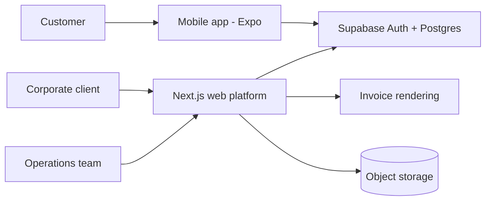

# TinBela: Corporate Meal Subscription Platform

> **Architecture case study.** Source code is private and owned by the client. This repository contains original documentation only: no client code, data, credentials or assets.

## Architecture



## Problem

Companies and individuals wanted reliable daily meals on subscription, with company-level billing for corporate customers and simple ordering for employees.

## Solution

A web platform for subscriptions, menus and operations, plus a React Native customer app with a postpaid wallet, both on one Supabase backend.

## Modules

- **Subscriptions**: plans, schedules, pause and resume
- **Menus and orders**: daily menus, ordering, cut-off times
- **Wallet and billing**: postpaid balance, invoices, corporate accounts
- **Customer app**: ordering and wallet on mobile
- **Operations**: kitchen and delivery views

## Tech stack

- Next.js, React 19, TypeScript, Tailwind CSS
- React Native (Expo) with NativeWind
- Supabase (Postgres, Auth)
- S3-compatible storage
- Server-side document generation (headless browser)

## Key design decisions

1. Two customer types (business and individual) share one order model, with billing rules attached to the account type.
2. A postpaid wallet lets corporate users order now and settle on a billing cycle.
3. Web and mobile use the same backend and auth so a customer has one identity everywhere.
4. Documents such as invoices are rendered server-side for consistent output.

## Illustrative data outline

Generic, simplified outline written for this case study. It is not the production schema.

```text
account(id, type[business|individual])
member(id, account_id)
plan(id, name, schedule) -> subscription(id, account_id, plan_id, status)
menu_day(date) -> menu_item(id, date)
order(id, member_id, menu_item_id, date)
wallet(account_id, balance, cycle) -> wallet_entry(id, account_id, amount, kind)
invoice(id, account_id, period, total)
```

---

Designed and delivered by [Adil Ahmed](https://github.com/AdilAhmedAhir) at [Start Daily xyz Limited](https://startdaily.xyz), Dhaka.
